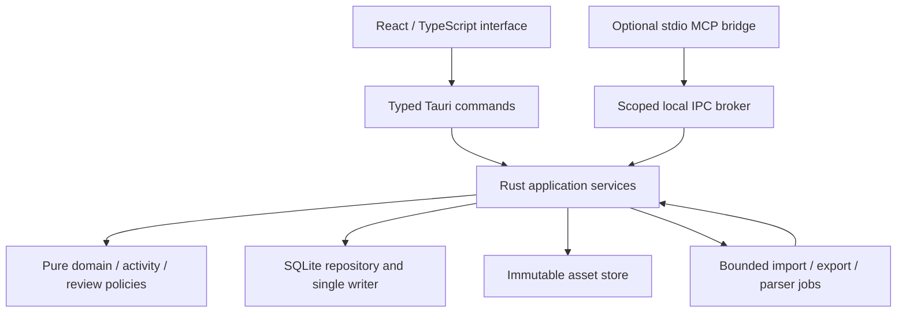

# Technical design

## Recommendation and decision status

Use **Rust, TypeScript, React, Tauri 2, and SQLite** as a local modular monolith. Tauri 2 is the deliberately selected stable family, not a claim that no newer previews exist. Pin exact compatible releases during M1. M1.1 now provides a published qualification fixture; the durable layer described here remains unimplemented. [M1.2 preparation](../planning/m1-2-workspace-preparation.md) refines that next step without starting it. [Technical alternatives and inspected versions](../research/technical-options.md) provide the comparison; [ADRs](decisions.md) define reconsideration conditions.

Tauri avoids a separate backend service and reuses Linux WebKitGTK; Rust suits validated domain/IO logic and the FSRS dependency; SQLite fits transactions, local ownership, and FTS5. TypeScript/React provide a mature interface ecosystem. These are practical judgments, not measured Memoquill footprint/performance results. A mandatory **M1 packaged Fedora/Orca/AT-SPI feasibility gate** tests the actual webview, editor, focus, and math/code workflows. If it fails without a bounded fix, revisit Electron or a native shell before domain expansion. Tauri 3 alpha is not a Foundation dependency.

## Components

These are modules in one desktop product, not network services. A parser job may use an isolated short-lived worker process; it is neither a permanent daemon nor an educational code runner. The MCP bridge exists only for an external client process and has no database access.

| Boundary | Responsibility and constraints |
| --- | --- |
| UI | Navigation, rich content/activity forms, sessions, accessibility, previews, settings, errors. No direct SQL, native filesystem, arbitrary shell, or scheduler implementation. |
| Tauri adapter | Small typed commands/events, selected-file handles, window/portal integration. Restrict capabilities to trusted app surfaces; imported content never obtains invoke privileges. |
| Application services | Use cases, permissions, revision/conflict checks, transactions, idempotency, jobs, audit, exports. Same services serve UI and MCP through different principals. No parallel duplicate “AI backend”. |
| Domain | Subject/collection/relationship invariants, activity schemas, attempt/evidence policy, scheduling adapter. Test without a UI. No provider, English, or Python assumptions. |
| Persistence | Embedded SQL migrations, referential integrity, revision snapshots, single writer, read queries, rebuildable indexes. |
| Files/jobs | Asset hashes, staged imports, cancellation, limits, normalization, backups, cleanup. Do not acknowledge success before durable state exists. |
| Platform adapter | XDG paths, Unix IPC, file dialogs/portals, permissions, notifications, packaging/update policy. Keep Linux mechanics out of domain contracts. |

## Interface and content editing

React with a small accessible component system (evaluate Radix primitives, styled locally) is the baseline. Avoid a large unverified design system. Use semantic HTML, visible labels, stable focus, keyboard menus/dialogs, and actual AT-SPI/Orca tests; a component library alone does not establish accessibility. No mandatory global state framework: typed query/service clients, local view state, and explicit session drafts suffice initially.

Select a mature editor adapter, initially evaluate ProseMirror/Tiptap core. Persist **Memoquill's versioned document schema**, not arbitrary editor-internal state. Paragraphs, headings, inline marks, lists, code, math, tables, media references, and unsupported-content placeholders have stable block IDs. Resources and activities remain different domain objects. Render math through a restricted local renderer such as KaTeX with untrusted commands/URLs disabled and an accessible source/MathML alternative; real screen-reader tests decide release readiness.

Original source bytes are always authoritative for originals; authored lesson revisions are authoritative for editable documents. Extracted documents explicitly identify the source revision/parser. Plain text, FTS, preview HTML, and Markdown exports are derived. A single universal representation is neither required nor claimed. Do not persist executable HTML as trusted content.

## Rust, persistence, and jobs

Use `rusqlite` with a pinned SQLite build enabling required JSON/FTS5 features; record the shipped version and compile options. Prefer explicit repositories/SQL over a large ORM. Domain operations are synchronous/pure where possible. A dedicated writer thread serializes mutations; Tauri async tasks and bounded workers perform IO without blocking the UI. Use the existing runtime needed by MCP/desktop adapters rather than introducing a second scheduler/framework.

Enable foreign keys on every connection, use WAL with a bounded checkpoint policy, explicit busy/error handling and `synchronous=FULL` for acknowledged durable writes. These are proposed settings requiring target-filesystem crash/latency qualification, not an absolute guarantee against faulty hardware. Keep the workspace on a supported local filesystem; network-filesystem databases are outside V1 support. See [data model](data-model.md) for transactions, migrations, and asset/database consistency.

Use SQLite FTS5 for resource/unit/activity text, with Unicode-aware normalization in derived indexes, filters, and stable result IDs. Retain original text/code exactly. FTS5 does not provide universal stemming, CJK segmentation, mathematical equivalence, or semantic search. Test representative multilingual queries; language-aware tokenizer/search extensions are conditional, not a second database. Rebuild search from canonical revisions after corruption or format change. [SQLite FTS5](https://sqlite.org/fts5.html).

## Learning services

Activity definitions have a type ID, schema version, validated payload, resource/objective links, and assessment policy. A built-in registry pairs schema, renderer, evaluation adapter, and migration. Unknown future types are preserved/exportable but disabled with explanation. Do not dynamically load executable third-party activity code in V1.

The session service freezes activity revisions, saves drafts, and records idempotent attempts before advancing. FSRS is isolated behind the recall-scheduler interface; the Rust library and algorithm version are recorded. Do not use memory stability for procedures, conceptual explanation, or code-writing competence. Progress is a projection over immutable attempts/evidence and content relevance, not a mutable global mastery score. [Learning model](../product/learning-model.md).

## Security, settings, and observability

Use restrictive Tauri capabilities/CSP, no remote frontend origin, no remote scripts/fonts/media fetch by default, and explicit external-link handling. Imported URLs are data; rendering them must not make network requests. Rich text is rendered from allowed nodes/attributes, with sanitized passive HTML only where a handler explicitly supports it. Parser workers receive only selected staged inputs and bounded output channels. No imported executable content runs.

Workspace preferences have schema/defaults and per-subject overrides. Message catalogs separate UI strings from learner content; use locale-aware display and preserve language metadata without requiring a language subject category. Structured local diagnostics carry operation IDs/timings/error codes and version information, redacting source/response content and grants. Provide explicit diagnostic export; no telemetry backend or response logging by default.

## Linux delivery and future evolution

M1 validates an actual Fedora RPM build; a development run may supplement but never replace the packaged gate. M7 qualifies **RPM as the initial supported Fedora artifact**, including WebKitGTK dependencies and Wayland/keyboard/Orca workflows. AppImage is conditional after testing the same workflows and dependency baseline; Flatpak is post-V1 unless portals/IPC and maintenance cost justify it. Avoid supporting several unqualified package types.

For V1, use signed release metadata/checksums and explicit manual updates; do not add a custom auto-updater. When installing through a package manager, follow that channel's update policy. Verify backup/migration compatibility before a new version activates a workspace. Update delivery/signing keys and release automation require separate publication authority; none is configured now.

Future portability benefits from platform adapters, UUIDs, immutable revisions, explicit ownership, and versioned exports. Do not build sync/conflict-free replication, cross-platform IPC implementations, or a plugin marketplace now. Cheap preparation is not a promise that future sync will be automatic.
